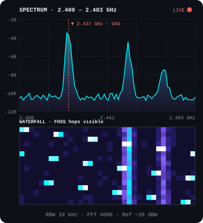
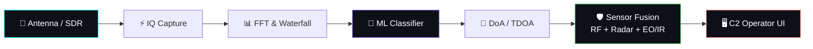

<p align="center">
  
</p>

<p align="center">
  
</p>

<p align="center">
  <a href="https://github.com/mach2furkan">
    
  </a>
</p>

<p align="center">
  
  
  
</p>


## `>_` Live Console

<p align="center">
  
</p>

<p align="center">
I design, analyze and prototype systems that combine <b>RF signal intelligence, spectrum awareness</b> and modern software engineering — especially in the context of <b>Counter-UAS (drone defense)</b>, early-warning architectures, and next-generation situational awareness platforms.
<br/><br/>
<b>🎯 My goal:</b> build technologies that make critical environments safer and smarter.
</p>


## 🛰 Sensor Feed

<table align="center">
  <tr>
    <td align="center"></td>
    <td align="center"></td>
  </tr>
  <tr>
    <td align="center"><sub><b>PPI DISPLAY</b> · RF + Radar track fusion</sub></td>
    <td align="center"><sub><b>SPECTRUM + WATERFALL</b> · 2.4 GHz ISM band</sub></td>
  </tr>
</table>


## 📡 RF Signal Intelligence (SIGINT)

<p align="center">
  
</p>

I actively research how advanced systems detect, classify, and visualize signals across crowded RF environments.

<details open>
<summary><b><code>$ cat focus_areas.txt</code></b> &nbsp;👈 click to toggle</summary>
<br/>

| | Area | Details |
|:-:|---|---|
| 📶 | **Spectrum monitoring** | Noise floor analysis (9 kHz – 153 GHz+) |
| 🛰 | **SDR pipelines** | RTL-SDR · HackRF · USRP · AirSpy |
| 🔍 | **Signal classification** | Modulation recognition, ML-assisted |
| 📡 | **DoA / AoA & geolocation** | TDOA, multilateration concepts |
| 🛡 | **C-UAS sensor fusion** | RF + Radar + EO/IR |
| ⚙ | **Tooling** | GNU Radio · Python · MATLAB · CubicSDR · SDR# |

</details>

<details>
<summary><b><code>$ ./pipeline --explain</code></b> &nbsp;🔽 click to run</summary>
<br/>



</details>

> [!NOTE]
> 🧭 All research here is strictly **ethical, legal, and educational** — signal analysis only, not interception or misuse.


## 🛡 Counter-UAS Expertise

<p align="center">
  
</p>

I work on understanding the architecture behind modern **anti-drone systems**:

<details open>
<summary><b><code>$ c-uas --layers</code></b></summary>
<br/>

```diff
+ [LAYER 1]  🎯 RF detection & signal fingerprinting
+ [LAYER 2]  📡 Radar integration for low-slow-small targets
+ [LAYER 3]  👁  EO/IR confirmation workflows
+ [LAYER 4]  🔗 C2 software and operator UI design
+ [LAYER 5]  🧩 System interoperability & layered defense concepts
! STATUS     all layers nominal — airspace monitored
```

</details>

> C-UAS is where **RF engineering, software, and defense-grade design meet** — and that intersection fascinates me.

<p align="center"><b>📬 If you're working on RF monitoring, drone defense or sensor fusion — let's talk.</b></p>


## 🛠️ Tech Stack

<p align="center">
  <br/>
  <br/>
  
</p>


## 📊 Signal Strength

<p align="center">
  
  
</p>

<p align="center">
  
</p>


