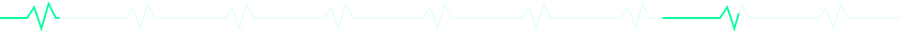
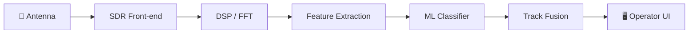

<b>🇬🇧 English</b> · <a href="README.tr.md">🇹🇷 Türkçe</a>

 

## `>_ Live Console`

I design, analyze and prototype systems that combine **RF signal intelligence**, **spectrum awareness** and **modern software engineering** — especially in the context of **Counter-UAS (drone defense)**, early-warning architectures and next-generation situational awareness platforms.

> 🎯 **Goal:** build technologies that make critical environments safer and smarter.

## 📡 RF Signal Intelligence (SIGINT)

I research how advanced systems **detect, classify and visualize** signals across crowded RF environments.

<code>$ cat focus_areas.txt</code> &nbsp;👈 click to toggle

 

| Area | Details |
|---|---|
| 📶 **Spectrum monitoring** | Noise floor analysis (9 kHz – 153 GHz+) |
| 🛰 **SDR pipelines** | RTL-SDR · HackRF · USRP · AirSpy |
| 🔍 **Signal classification** | Modulation recognition, ML-assisted |
| 📡 **DoA / AoA & geolocation** | TDOA, multilateration concepts |
| 🛡 **C-UAS sensor fusion** | RF + Radar + EO/IR |
| ⚙ **Tooling** | GNU Radio · Python · MATLAB · CubicSDR · SDR# |

<code>$ ./pipeline --explain</code> &nbsp;🔽 click to run

 

> [!NOTE]
> 🧭 All research here is strictly **ethical, legal and educational** — signal analysis only, no interception or misuse.

## 🛡 Counter-UAS Expertise

I work on understanding the architecture behind modern anti-drone systems — layered, redundant, operator-centric.

C-UAS is where **RF engineering, software and defense-grade design** meet — and that intersection fascinates me.

## 🚀 Featured Projects

<table>
<tr>
<td width="50%" valign="top">

### 📻 [CUAS_RF_CONSOLE](https://github.com/mach2furkan/CUAS_RF_CONSOLE)

RF-based Counter-UAS operator console.

</td>
<td width="50%" valign="top">

### 📈 [rf-spektrum-analyzer](https://github.com/mach2furkan/rf-spektrum-analyzer)

Browser-based real-time spectrum analyzer.

</td>
</tr>
<tr>
<td width="50%" valign="top">

### 🛰 [embeddedisuspringradar](https://github.com/mach2furkan/embeddedisuspringradar)

Embedded radar prototype.

</td>
<td width="50%" valign="top">

### 🛡 [AEGIS-OS](https://github.com/mach2furkan/AEGIS-OS)

Defense-themed situational awareness interface.

</td>
</tr>
<tr>
<td width="50%" valign="top">

### 🎯 [missile-intercept](https://github.com/mach2furkan/missile-intercept)

Interception simulation written in Go.

</td>
<td width="50%" valign="top">

### 👁 [OpticLockPro_Project](https://github.com/mach2furkan/OpticLockPro_Project)

Optical tracking and target lock.

</td>
</tr>
<tr>
<td width="50%" valign="top">

### ✈ [uavlandingsimhlator](https://github.com/mach2furkan/uavlandingsimhlator)

UAV landing simulator.

</td>
<td width="50%" valign="top">

### 🌊 [marinesecurity](https://github.com/mach2furkan/marinesecurity)

Maritime security and monitoring platform.

</td>
</tr>
</table>

## 🛠️ Tech Stack

## 📊 GitHub Telemetry

## 📬 Let's Talk

If you're working on **RF monitoring, drone defense or sensor fusion** — let's connect.

 

